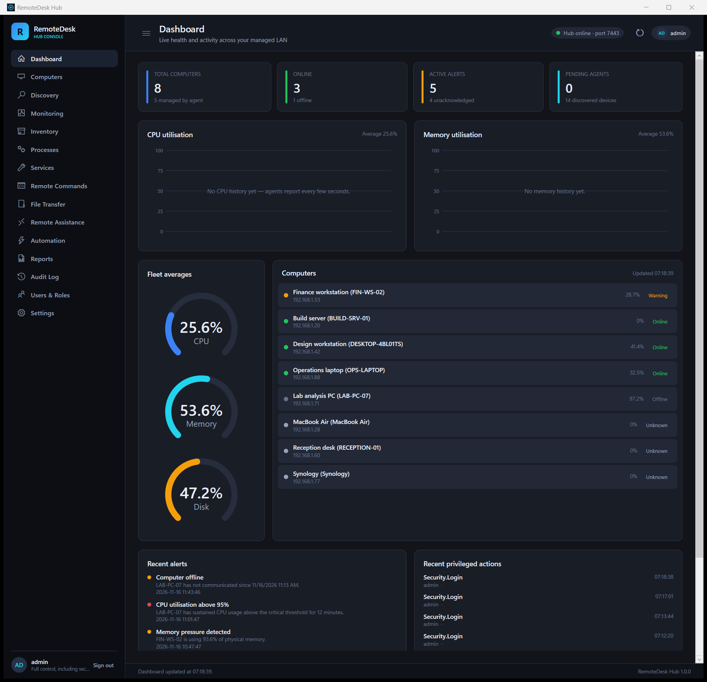
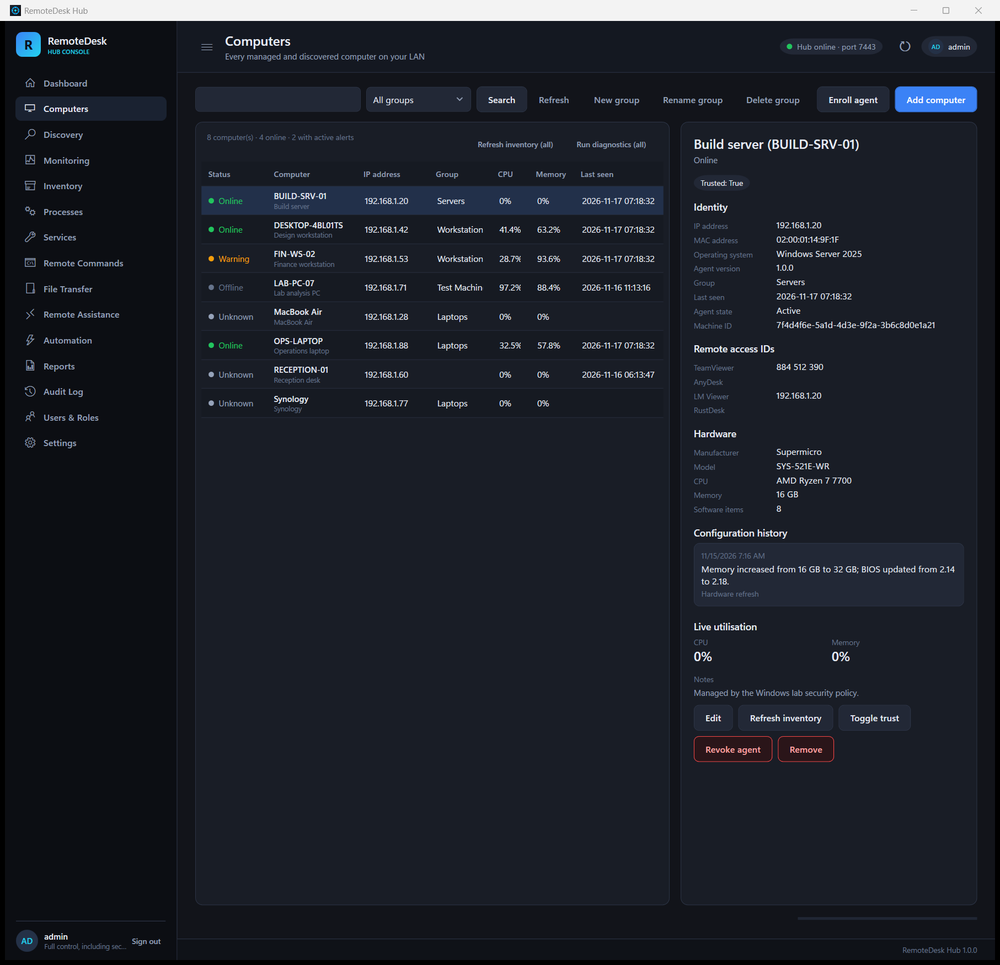
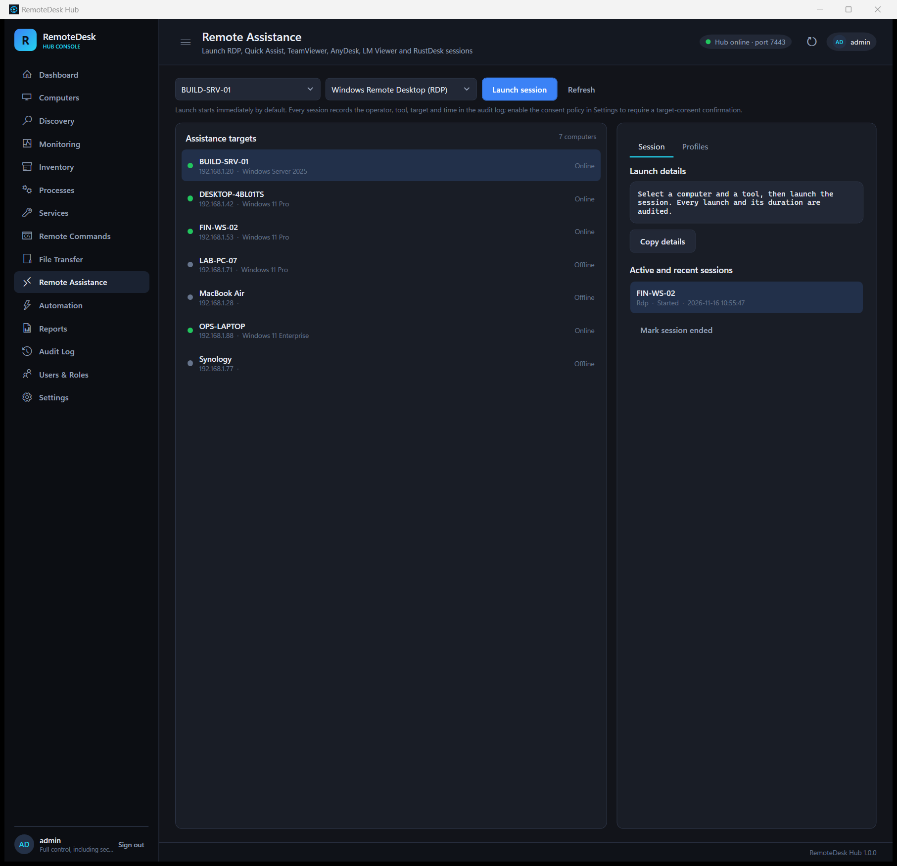
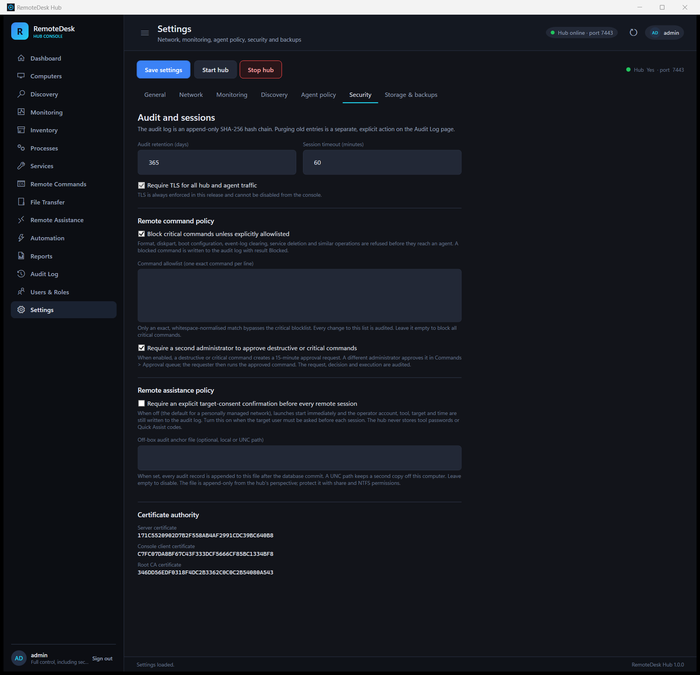
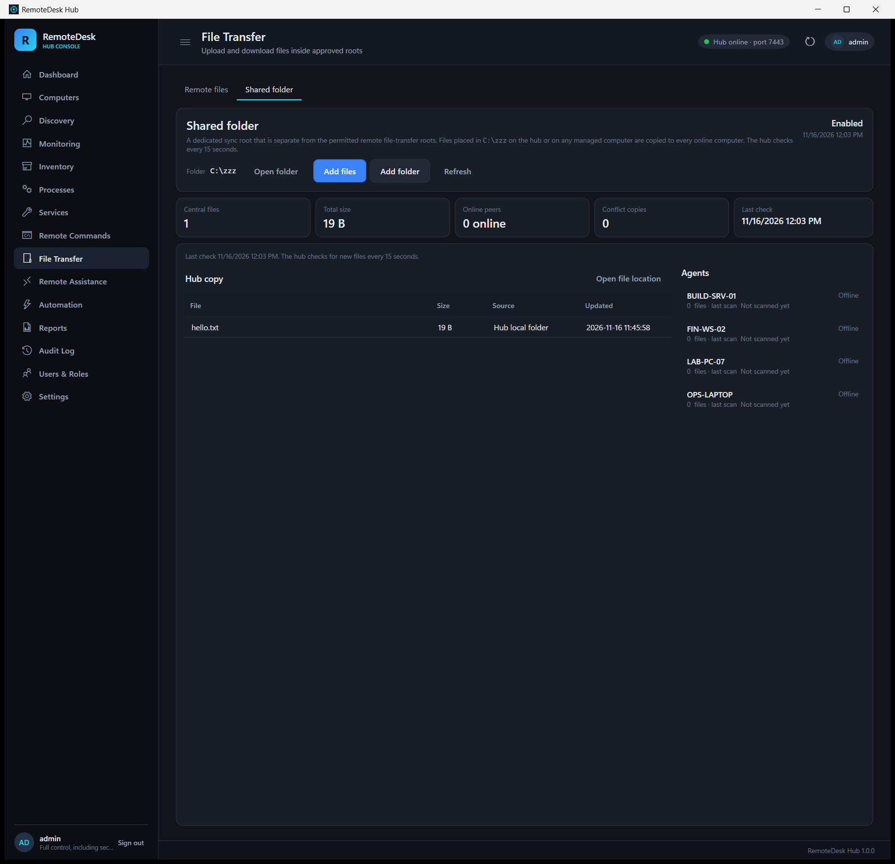

# RemoteDesk Hub

RemoteDesk Hub is a Windows management console for computers on a private LAN. It discovers
machines, enrolls a signed RemoteDesk Agent on each computer, and gives administrators a single
place to monitor health, run auditable commands, manage processes and services, transfer files,
launch support sessions, schedule automation and export reports.

The product has two components:

| Component | Technology | Installed by |
| --- | --- | --- |
| **RemoteDesk Hub** | WPF desktop application (.NET 10, MVVM) | `RemoteDesk-Hub-1.0.0-x64.msi` |
| **RemoteDesk Agent** | Windows service (.NET 10 Worker) | `RemoteDesk-Agent-1.0.0-x64.msi` |

Both are 64-bit Windows applications. The hub is a per-machine install; each interactive
administrator keeps their own hub database under `%LOCALAPPDATA%\RemoteDeskHub`. The agent runs as
`LocalSystem` and stores its state under `%ProgramData%\RemoteDesk Agent`.

## About

RemoteDesk Hub is a self-hosted Windows LAN management product. It is built for administrators who
need discovery, inventory, health monitoring, remote commands, process and service control, file
transfer, a shared folder, support-session records, automation and reports without a cloud account
or an internet dependency. The hub creates its own private certificate authority; agents enroll with
single-use pairing packages and are approved by an administrator. Every privileged operation is
role-checked, confirmed where appropriate, and written to a tamper-evident audit chain.

The desktop console is a WPF application with a dark charcoal interface, live charts, 15 management
pages and a nine-step first-run wizard. The headless `RemoteDeskHub.HubHost.exe` keeps the listener
and background scheduler running when the console window is closed. See the documented limitations
before treating this as a production replacement for a commercial RMM product.

## Highlights

- **LAN-only by default.** Discovery scans private IPv4 subnets, enrollment rejects public source
  addresses, and TLS is mandatory.
- **Private certificate authority.** On first run the hub creates an RSA-4096 root CA, a hub TLS
  certificate and a console client certificate. Agent certificates are issued from CSRs and pinned
  by thumbprint. Agents also pin the hub TLS server thumbprint, and the hub ignores SAN/EKU values
  supplied in an agent CSR. Agents renew automatically before expiry through an authenticated
  `/api/agent/renew` endpoint; the old thumbprint is replaced atomically and the old certificate is
  rejected immediately.
- **Headless hub host.** Published installations include `RemoteDeskHub.HubHost.exe`. The console
  launches it when needed and talks to it over the same private-CA HTTPS listener, so closing a
  console window does not stop the listener. Development builds fall back to the in-process host.
  This is a same-session process, not yet a Windows service; see [ARCHITECTURE.md](docs/ARCHITECTURE.md).
- **Explicit enrollment.** Agents need a single-use pairing package (`.rdhenroll`). Administrators
  approve each request unless they opt into automatic approval for that token. The status token is
  sent in a request header and protected with DPAPI in the agent state file; the plaintext pairing
  package is deleted once the token has been imported.
- **Role-based access control.** Viewer, Operator and Administrator roles gate navigation and every
  service call. Sensitive operations require confirmation. User, audit, settings, automation,
  backup and monitoring entry points are guarded in the service layer, not only in the UI.
- **Tamper-evident audit log.** Every privileged action is written to a SHA-256 hash chain that can
  be verified from the Audit Log page.
- **Real monitoring.** CPU, memory, disk, network and temperature samples are collected by the
  agent, stored in SQLite and rendered as live charts and bucketed history. Alerts deduplicate,
  honour the configured cooldown and resolve automatically when the metric recovers. Metric
  retention is enforced daily by the background service.
- **Real remote administration.** Commands run through PowerShell or `cmd.exe` on the agent;
  process termination, service control and file transfer are implemented against the agent API with
  guard rails for protected processes, critical services and permitted file roots. Critical
  commands are blocked before they reach an agent unless an administrator adds the exact,
  whitespace-normalised command to the security allowlist. Command audit rows include SHA-256
  transcript hashes for stdout and stderr. When the approval policy is enabled, destructive or
  critical commands also require approval by a different administrator before the requester can run
  them; requests, decisions and execution are audited.
- **One-click remote assistance.** The Remote Assistance page launches RDP, Quick Assist, Windows
  Remote Assistance, TeamViewer, AnyDesk, LM Viewer, RustDesk or a configured third-party tool
  against an online computer. Every launch records the operator, tool, target and time, and the
  session moves through prepared, started, failed and ended states. Consent is a policy switch: it
  is off by default for immediate launches, and enabling `security.remoteConsentRequired` restores
  the explicit consent dialog. The hub does not embed a desktop viewer or store passwords or Quick
  Assist codes. The Agent MSI creates an inbound TCP 3389 rule only when installed with
  `ENABLE_RDP_FIREWALL=1`; it never enables Remote Desktop or grants sign-in rights.
- **Stable computer identity.** Re-enrollment matches the Windows `MachineGuid` or the persisted
  installation ID, so a computer keeps the same record, remote-access IDs and history after a
  restart, DHCP address change or agent reinstall.
- **Configuration history.** Hardware inventory is compared on every refresh; changed
  configurations are preserved as snapshots with a readable change summary for upgrade comparison.
- **Offline-tolerant telemetry.** The agent buffers important telemetry in a durable local queue
  while the hub is unreachable and replays it oldest-first after reconnecting.
- **Optional off-box audit anchor.** After each database commit, audit records can also be appended
  as JSON Lines to a local or UNC path configured in Settings, so the hash chain survives loss of
  the hub data folder.
- **Reports.** CSV, HTML and PDF exports are generated in memory and saved through a file dialog.
- **Shared folder.** A dedicated `C:\zzz` on the hub and on every managed computer is synchronized
  through the hub. Files and folders can be added from the console or dropped in with File Explorer.
  The hub checks every 15 seconds, verifies SHA-256 hashes, preserves simultaneous edits as conflict
  copies, and propagates deletions as tombstones. See [SHARED_FOLDER.md](docs/SHARED_FOLDER.md).
- **Safe restores.** A restore is staged and applied on the next startup, before any database
  connection is opened, instead of overwriting a live SQLite file while background services run.

## Screenshots

The images below are captured from the real WPF console running against a local SQLite database. The
demo data is seeded test data, not a live customer network.

### Dashboard



### Computers



### Remote assistance



### Security and audit policy



### Shared folder



## Quick start

Prerequisites: Windows 10/11 x64 and the .NET 10 SDK (10.0.403 or later). Installer builds also need
WiX Toolset 5.

```powershell
# Build, run all tests
powershell -NoProfile -ExecutionPolicy Bypass -File .\scripts\build.ps1

# Publish self-contained binaries and build both MSIs
powershell -NoProfile -ExecutionPolicy Bypass -File .\scripts\build-installers.ps1 -Version 1.0.0
```

Then:

1. Install `artifacts\installers\RemoteDesk-Hub-1.0.0-x64.msi` on the management computer.
2. Start **RemoteDesk Hub** and complete the nine-step first-run wizard.
3. On **Computers**, choose **Enroll agent**, set the hub address agents will use, and generate a
   pairing package.
4. Install the Agent MSI on the target computer, either with
   `PAIRINGPACKAGE="C:\path\site.rdhenroll"` or by copying the package to
   `%ProgramData%\RemoteDesk Agent\enroll.rdhenroll` and restarting the service. Add
   `ENABLE_RDP_FIREWALL=1` only if the target must accept inbound RDP through Windows Firewall.
5. Approve the pending agent in **Computers → Agent enrollments** (unless the token was created
   with automatic approval).

Detailed instructions are in [docs/INSTALLATION.md](docs/INSTALLATION.md) and
[docs/AGENT_DEPLOYMENT.md](docs/AGENT_DEPLOYMENT.md).

## Download

Release assets are attached to [GitHub Releases](https://github.com/unupunct/RemoteDeskHub/releases/latest):

| Asset | Purpose |
| --- | --- |
| `RemoteDesk-Hub-1.0.0-x64.msi` | WPF hub console and headless hub host |
| `RemoteDesk-Agent-1.0.0-x64.msi` | RemoteDesk Agent Windows service |
| `SHA256SUMS.txt` | SHA-256 checksums for both MSIs |

```powershell
Get-FileHash .\RemoteDesk-Hub-1.0.0-x64.msi -Algorithm SHA256
Get-FileHash .\RemoteDesk-Agent-1.0.0-x64.msi -Algorithm SHA256
```

The MSIs are unsigned unless the release notes say otherwise. Verify the checksum before running
them, and compare it with `SHA256SUMS.txt`.

## Repository layout

```
src/
  RemoteDeskHub.Shared/        Protocol DTOs, enums, path/network guards
  RemoteDeskHub.Core/          Domain entities, permissions, service contracts, view models
  RemoteDeskHub.Infrastructure/ EF Core SQLite store, all hub services, reports
  RemoteDeskHub.Networking/    Private CA, HTTPS hub server, agent HTTP client
  RemoteDeskHub.Agent/         Windows service, collectors, command/file API
  RemoteDeskHub.HubHost/       Headless hub host used by published installations
  RemoteDeskHub.Desktop/       WPF shell, 15 pages, first-run wizard, dark theme
tests/
  RemoteDeskHub.UnitTests/         Security, path, network and protocol tests
  RemoteDeskHub.IntegrationTests/  Real SQLite + real Kestrel HTTPS/mTLS flows
tools/
  RemoteDeskHub.LoadTest/          Loopback load, fault and audit-contention harness
installer/                     WiX v5 sources and EULA
scripts/                       Build, publish and installer scripts
docs/                          Operator and engineering documentation
```

## Documentation

| Document | Contents |
| --- | --- |
| [BUILD.md](docs/BUILD.md) | Toolchain, build, test, publish and installer commands |
| [CI.md](docs/CI.md) | GitHub Actions gates, installer E2E tests and code signing |
| [INSTALLATION.md](docs/INSTALLATION.md) | Hub installation, first run, upgrade and removal |
| [AGENT_DEPLOYMENT.md](docs/AGENT_DEPLOYMENT.md) | Agent MSI, pairing packages, command-line use |
| [NETWORK_CONFIGURATION.md](docs/NETWORK_CONFIGURATION.md) | Ports, bind addresses, TLS, firewall, discovery |
| [SECURITY.md](docs/SECURITY.md) | Identity, mTLS, RBAC, audit chain, DPAPI, threat model |
| [USER_GUIDE.md](docs/USER_GUIDE.md) | Every page in the console and the first-run wizard |
| [SHARED_FOLDER.md](docs/SHARED_FOLDER.md) | Dedicated `C:\zzz` sync, conflict copies, limits and troubleshooting |
| [ARCHITECTURE.md](docs/ARCHITECTURE.md) | Projects, data model, request flows, design decisions |
| [TESTING.md](docs/TESTING.md) | Test strategy, exact results and what was not tested |
| [LOAD_TESTING.md](docs/LOAD_TESTING.md) | Load, fault and audit-contention harness and measured results |
| [TROUBLESHOOTING.md](docs/TROUBLESHOOTING.md) | Diagnostics, logs, common failures, recovery |

## Verification status

The solution builds with **0 warnings and 0 errors**. **171 unit tests** and **108 integration
tests** (279 total) pass on the development machine (Windows 11 Pro, .NET SDK 10.0.403). Integration
tests use a real SQLite database and a real Kestrel HTTPS listener with mutual TLS on loopback, and
cover certificate issuance and SAN constraints, certificate renewal, enrollment, replay rejection,
audit-chain tampering, concurrent audit writes, command policy, service-layer authorization, staged
backup restore, alert cooldown, remote administration guard rails, shared-folder local/agent
reconciliation, conflict copies, deletion tombstones and report generation.

The loopback load harness was run locally: 12 synthetic agents x 10 heartbeats completed 120/120
requests with 0 errors at 82 requests/second (p50 5 ms, p95 483 ms, p99 1,266 ms); a fault run
stopped and restarted the hub and completed 48 post-fault requests with 0 errors; 8 concurrent
audit writers completed 400/400 rows and the hash chain verified. These are single-machine
measurements, not a capacity plan. See [LOAD_TESTING.md](docs/LOAD_TESTING.md).

**Not performed locally:** multi-machine or physical-LAN testing. Only one Windows computer was
available. Enrollment, heartbeat, remote administration and file transfer were exercised in-process
and over loopback HTTPS, not between two physical computers. Shared-folder synchronization was
verified with the hub-local peer and a simulated agent transport, and by placing a file in the local
`C:\zzz` while the console was running; it was not tested between two physical computers. The MSIs
were built and their tables validated read-only, but they were not installed or uninstalled from the
non-elevated build shell. The headless hub host is a same-session process, not a Windows service; see
[ARCHITECTURE.md](docs/ARCHITECTURE.md) for the remaining service-account key-storage limitation.

The repository includes a GitHub Actions gate (`.github/workflows/ci.yml`) that builds the
solution, runs the tests, runs CodeQL and vulnerability checks, builds 1.0.0 and 1.0.1 MSIs, and
performs an elevated install → upgrade → uninstall test on `windows-latest`. The 1.0.0 release run
passed all three jobs. Signing activates when the `CODE_SIGNING_PFX_BASE64` and
`CODE_SIGNING_PFX_PASSWORD` secrets are configured; this release is unsigned. See
[CI.md](docs/CI.md) and [TESTING.md](docs/TESTING.md) for the exact status.

## License

Proprietary. See the EULA shown by the installers (`installer/License.rtf`). QuestPDF is used under
its Community license for PDF report generation.


